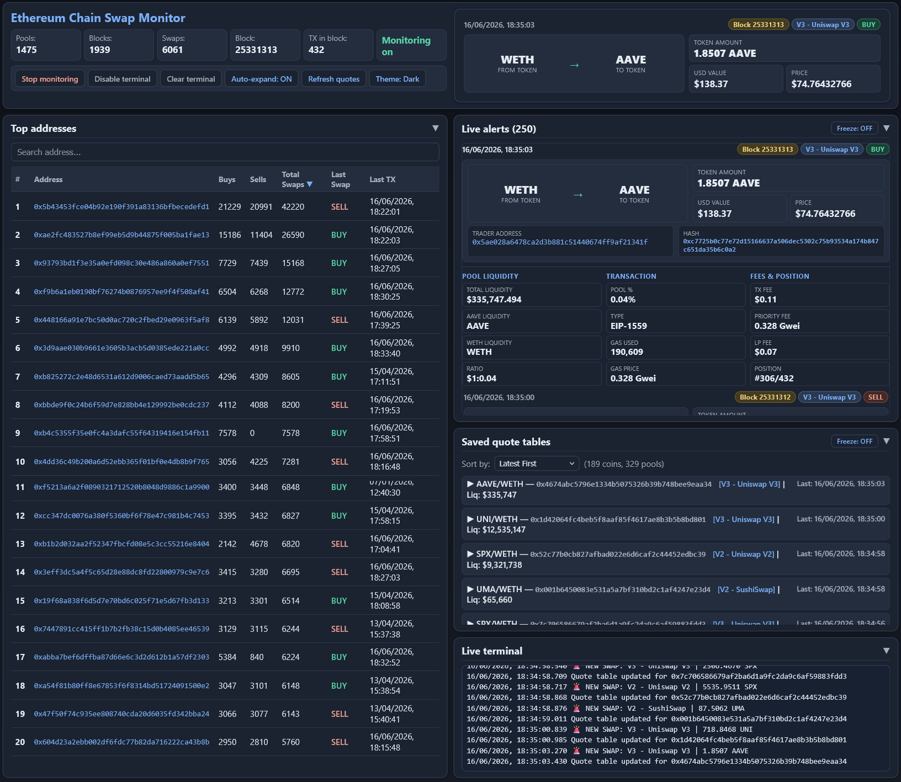
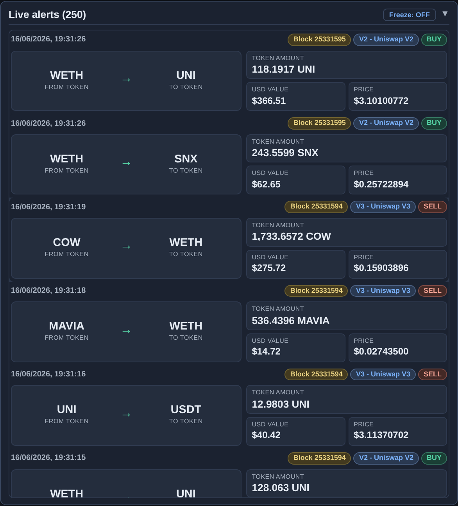
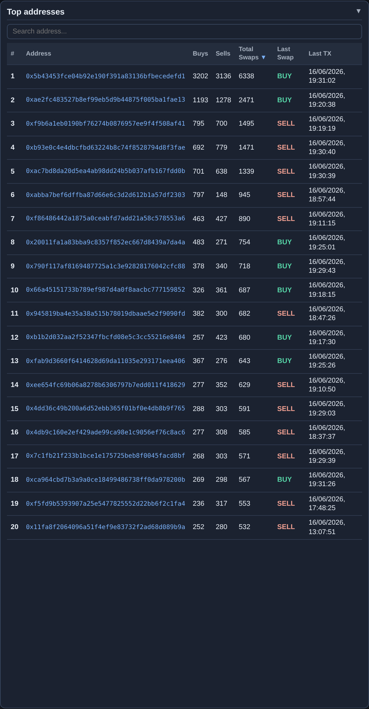
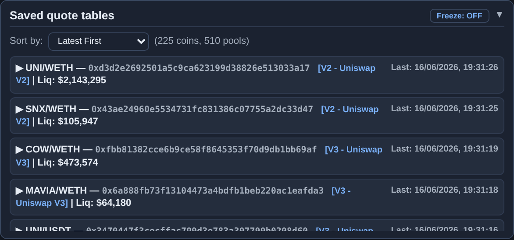
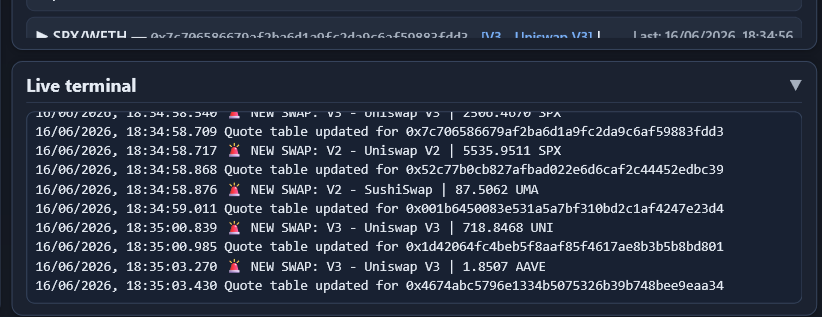
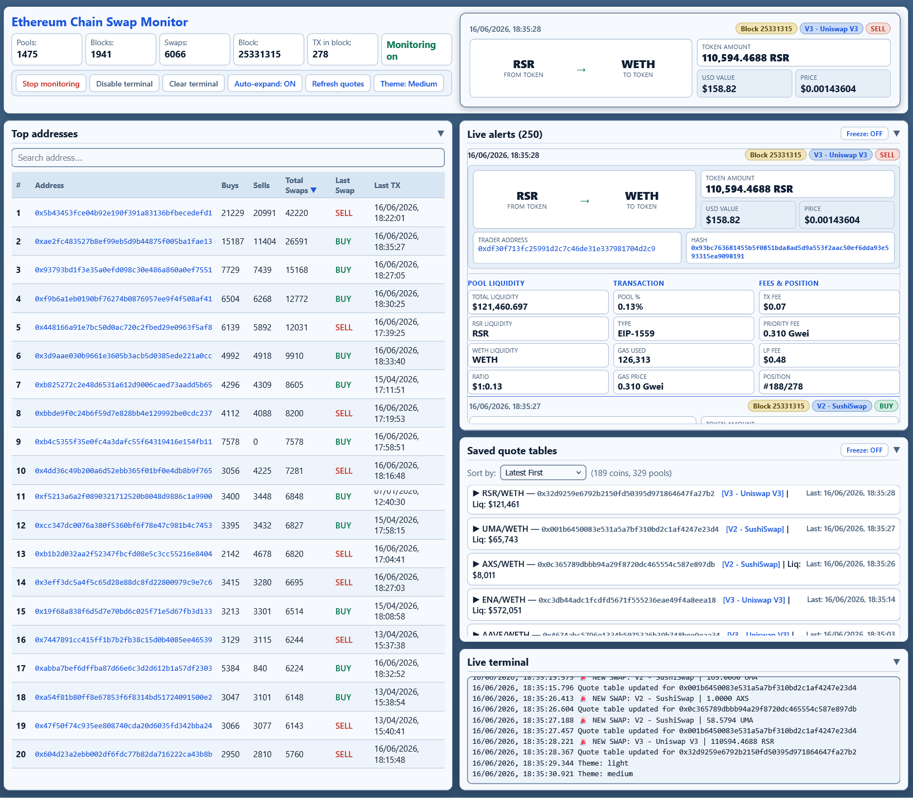
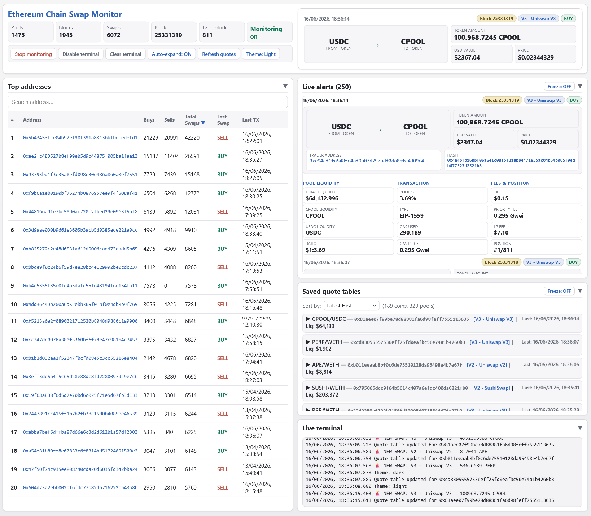

# Ethereum Chain Swap Monitor

Following on-chain swaps is easier when transactions, recurring addresses and live context share one workspace. Ethereum Chain Swap Monitor brings those views together so an operator can observe activity, narrow an investigation and keep useful comparisons nearby.

## Tech stack

| Layer | Technologies |
|---|---|
| Application | Python |
| Supporting technologies | HTML, CSS, JavaScript; Ethereum; WebSockets |

## Follow the live swap feed

The alert feed presents relevant swaps in a form that can be scanned and expanded for detail. Session information and monitoring controls keep the current observation context visible. This helps the operator follow activity without opening each transaction as a separate task.

## Investigate recurring addresses

Address rankings draw attention to participants that recur in the observed activity. Search and address-focused panels support narrowing the investigation from the general feed. The information helps identify what to inspect next rather than claiming to explain a trader's intent.

## Keep comparisons nearby

Saved quote tables and swap-preview controls provide supporting context alongside the feed. They let the operator retain useful comparisons during a monitoring session. Keeping these views together reduces repeated switching between observation and comparison tools.

## Watch the operating context

A live terminal and connection information assist when the feed appears quiet or interrupted. Monitoring mode controls support the available observation choices. They provide visibility into the session without requiring a public explanation of the internal monitoring engine.

## Choose a comfortable presentation

Dark, medium and light themes support different viewing conditions, while collapsible panels help control the amount of detail on screen. The available images show the main feed and supporting areas. The product presentation can focus on those investigative workflows rather than setup instructions.

---

Private code: [eth-chain-swaps-monitor](https://github.com/logicencoder/eth-chain-swaps-monitor)

See [REPOS.md](REPOS.md) for related repositories.

**[Logic Encoder](https://logicencoder.com)** · [GitHub](https://github.com/logicencoder) · [Contact](https://logicencoder.com/contact/)
