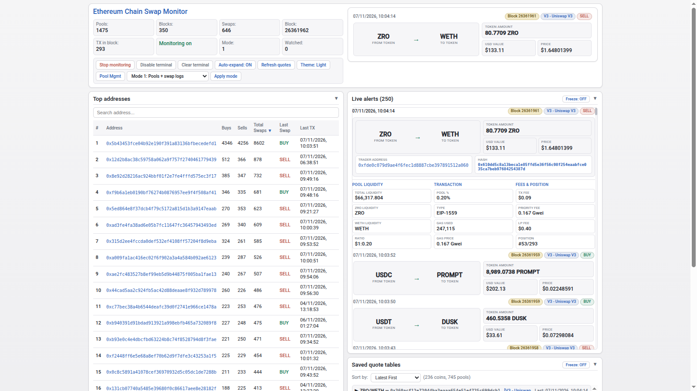
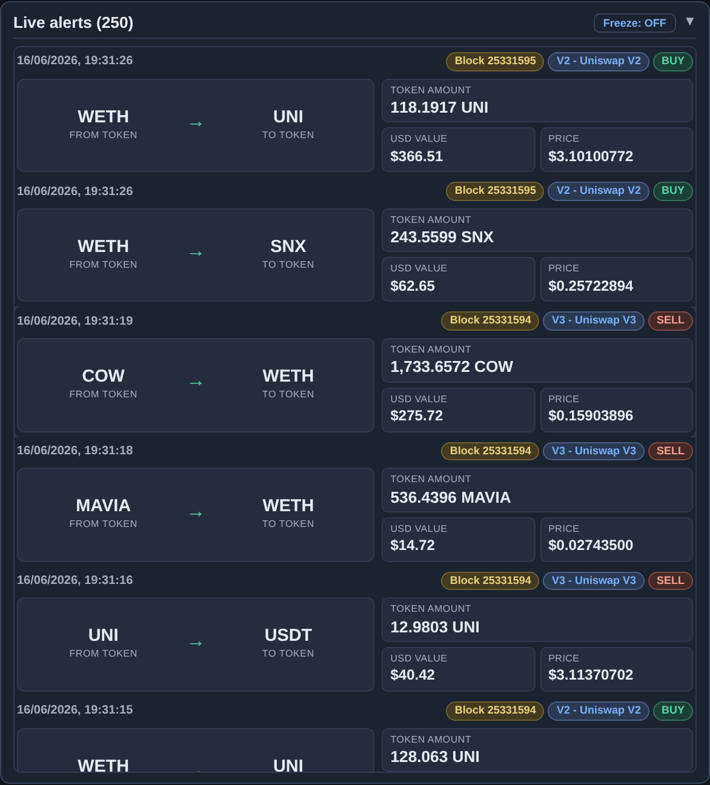
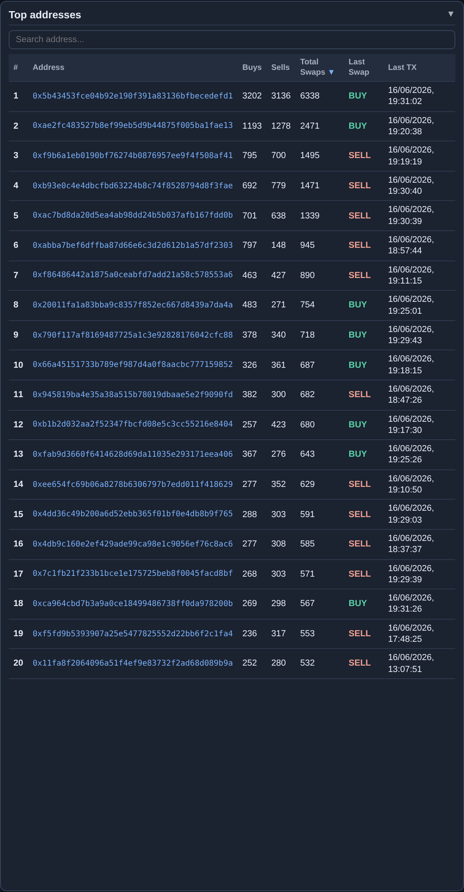
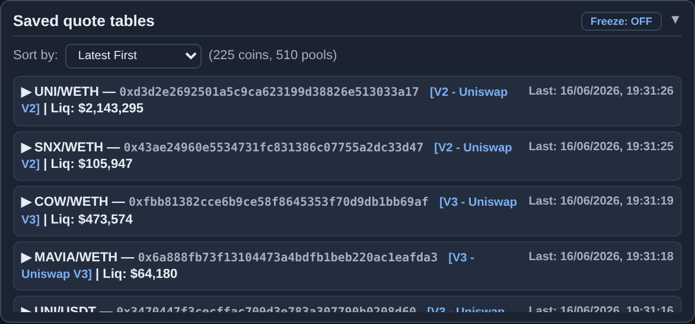
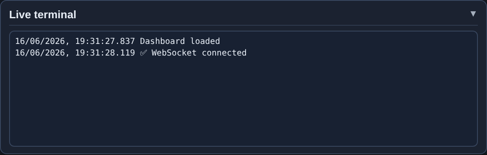
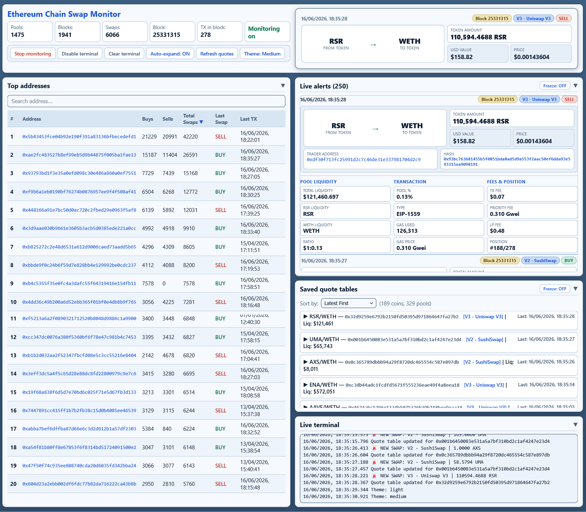
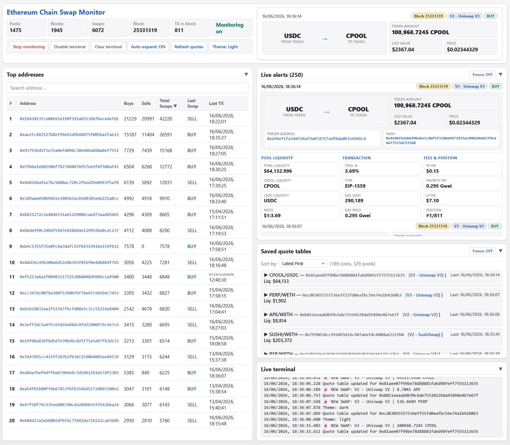

# Ethereum Chain Swap Monitor

Ethereum Chain Swap Monitor follows swaps on Ethereum in real time. A Python process reads new blocks and logs from an Ethereum node, recognises swaps in known liquidity pools, values them in dollars and shows them in a live dashboard with alerts, the most active addresses, saved quote tables and a live terminal. It is a self-hosted operator tool for people who want to watch large or unusual swap activity as it happens.

## Tech stack

| Layer | Technologies |
|---|---|
| Application | Python |
| Supporting technologies | HTML, CSS, JavaScript; Ethereum; WebSockets |

## Follow the live swap feed

The **Live Alerts Feed** keeps the latest 250 swaps in a list that can be scanned and expanded for detail; auto-expand opens new entries as they arrive and a freeze switch stops the list moving while you read. **Stop monitoring** pauses the scan without closing the dashboard.

The feed provides a starting point for examining a particular swap or a period of activity. Keep the transaction context visible while moving into the views relevant to the question.

## Investigate recurring addresses

The **Top 20 Most Active Addresses** ranking shows the participants that recur in the observed swaps, and the search box looks up any address. The ranking tells you what to inspect next; it does not explain a trader's intent.

Repeated participants can be easier to understand when their observations are grouped for review. Move from a single event to the available address information without reconstructing the investigation.

## Keep comparisons nearby

**Saved Quote Tables** keep a quote per pool for comparison next to the feed; **Refresh quotes** updates them and they can be ordered latest or oldest first, by coin name (A to Z or Z to A) or by liquidity (highest or smallest).

Market comparisons provide another perspective on the activity being watched. Keeping quotes near the chain observations helps the operator examine context within one workspace.

## Watch the operating context

The **Live Terminal** shows what the monitor is doing and can be disabled or cleared. Four monitoring modes decide what is read: pools with swap logs, a watchlist with swap receipts, pools with all logs, or a watchlist with all transactions (apply the mode with one button; modes 2 and 4 currently behave the same). A **Pool Mgmt** page switches individual pools on or off and records the reason.

Operational information matters when a quiet view might reflect either little activity or an interruption. The terminal and status views help the operator inspect that distinction.

## Choose a comfortable presentation

Three themes (dark, medium and light) change the colours, and every panel can be collapsed, which helps when the monitor stays open for a long session.

Theme and display choices let the same information fit different working conditions. A comfortable presentation is especially useful when the monitor remains open for an extended session.

The light presentation offers another working environment for the same swap-monitoring tasks. Theme choice changes readability preferences while the investigation remains centred on the selected observations.

---

Private code: [eth-chain-swaps-monitor](https://github.com/logicencoder/eth-chain-swaps-monitor)

See [REPOS.md](REPOS.md) for related repositories.

**[Logic Encoder](https://logicencoder.com)** · [GitHub](https://github.com/logicencoder) · [Contact](https://logicencoder.com/contact/)
